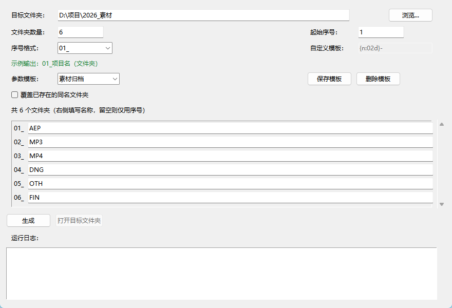

# 批量建文件夹工具 · Batch Folder Creator


一个 Windows 单文件 GUI 小工具：在指定目录里，按「**序号前缀 + 你逐行填写的名称**」批量创建空文件夹，用来给项目搭目录骨架。

双击即用，不需要安装 Python，也不需要任何运行库。

---

## 它解决什么

做项目时先铺一套有顺序的目录（`01_AEP`、`02_MP3`、`03_MP4`……），而不是一个一个右键新建。这个工具把「序号规则」和「名称清单」分开：上面定规则，下面逐行填名字，右侧实时显示预览。

## 界面与效果



上面这张是程序**真实启动后抓取的界面截图**（不是示意图）：目标目录、数量 6、起始 1、序号格式 `01_`，下方逐行列出 6 行，右侧分别填了 `AEP / MP3 / MP4 / DNG / OTH / FIN`。

点「生成」后，资源管理器里得到这样一组目录：


## 功能

| 项 | 说明 |
|---|---|
| 目标文件夹 | 默认为 exe 所在目录，可点「浏览…」改；目录不存在会自动创建 |
| 文件夹数量 / 起始序号 | 例如数量 5、起始 3 → 从第 3 项开始编号 |
| 序号格式 | 11 个样式预设 + 一个自定义模板串输入框 |
| 逐行清单 | 数量决定行数，每行左侧显示序号前缀、右侧填名称；留空则只生成序号 |
| 实时示例 | 显示首个文件夹的实际名字，如 `01_项目名` |
| 参数模板 | 把整套参数存成命名模板，下次下拉一键回填（见下节） |
| 覆盖开关 | 关闭时遇到同名文件夹跳过并记日志 |
| 运行日志 | 逐条显示已创建 / 已跳过 / 失败原因，结束后可一键打开目标文件夹 |

调整数量、起始序号或格式时，已填写的名称按行保留，不会清空。Windows 文件夹名非法字符（`" < > : / \ | ? *`）会被移除。

## 序号格式

预设只决定**序号前缀长什么样**，与名称无关：

| 预设 | 示例（起始=1） | 预设 | 示例 |
|---|---|---|---|
| `1_` | `1_项目名` | `01_` | `01_项目名` |
| `1-` | `1-项目名` | `01-` | `01-项目名` |
| `1.` | `1.项目名` | `001_` | `001_项目名` |
| `1、` | `1、项目名` | `一、` | `一、项目名` |
| `第1章 ` | `第1章 项目名` | `(1) ` | `(1) 项目名` |

选「自定义…」后，右侧输入框可写任意模板串：

- `{n}` 阿拉伯数字，可带格式 `{n:02d}` 补零、`{n:03d}` 三位补零
- `{cn}` 中文数字（一、二、三……）
- 其余文字原样保留，例如 `第{n}节 ` → `第1节 项目名`、`{n:03d}. ` → `001. 项目名`

模板里若没写 `{n}` 或 `{cn}`，实时示例会提示「序号不会变化」。

## 参数模板


模板解决的是「同一套项目骨架要反复铺」：把**整套参数**存成一个名字，下次下拉选中即全部回填，不用重新填一遍。

- **保存模板**：点「保存模板」，输入名称，把当前的目标目录、数量、起始序号、序号格式、自定义串、覆盖开关、以及逐行名称清单一起存下
- **加载模板**：在下拉框选中即回填所有参数并重建逐行列表（上图就是加载「素材归档」后的状态）
- **删除模板**：选中后二次确认删除
- **存哪**：exe 同目录的 `templates.json`。它是纯 JSON、跟着 exe 走，把 exe 拷到 U 盘或另一台电脑，模板也跟着过去
- **留空给你自己做**：软件内**没有内置预设模板**，下拉框初始只有一个「选择模板」占位项

一份模板的实际结构（对应 `_collect_config()` 的字段）：

```json
{
  "素材归档": {
    "dir": "D:\\项目\\2026_素材",
    "count": 6,
    "start": 1,
    "format": "01_",
    "custom_fmt": "{n:02d}-",
    "overwrite": false,
    "names": ["AEP", "MP3", "MP4", "DNG", "OTH", "FIN"]
  }
}
```

模板目前没有导入 / 导出界面，也没有版本迁移；老版本模板里多出来的字段会被忽略。

## 使用

**方式 A · 直接用（推荐）**
下载 `dist/批量建文件夹.exe`，双击运行。把 exe 放在哪个目录，默认就在哪个目录建文件夹；`templates.json` 也跟着 exe 走。

**方式 B · 跑源码**

```bash
py -3.12 batch_file_creator.py
```

需要 Python 3.12 且带 tkinter。注意：WorkBuddy 自带的精简版 Python 3.13 没有 tkinter 和 PyInstaller，请用系统 `py -3.12`。

**方式 C · 重新打包**

```bash
build.bat
```

等价于 `py -3.12 -m PyInstaller --onefile --windowed --clean --icon folder_plus.ico --name 批量建文件夹 batch_file_creator.py`。

若打包时提示无法覆盖旧的 `dist\批量建文件夹.exe`，先手动删掉或改名旧 exe 再跑。

## 文件构成

| 路径 | 作用 |
|---|---|
| `batch_file_creator.py` | 主程序，仅标准库 tkinter |
| `dist/批量建文件夹.exe` | 已构建的单文件成品，约 10 MB |
| `make_icon.py` | 用 Pillow 绘制并手工拼装多尺寸 ICO |
| `folder_plus.ico` | 应用图标，9 个尺寸（16–256px） |
| `build.bat` | 一键重新打包 |
| `docs/make_screenshot.py` | 可复跑：启动 GUI、加载示例模板、抓界面截图，内含断言 |
| `docs/screenshot-templates.png` | 完整 GUI 截图 |
| `docs/screenshot-template-detail.png` | 模板操作区局部截图 |
| `docs/example-folders.png` | 生成结果示例（实机截图，已裁掉空白） |
| `docs/icon.png` | 256px 图标预览 |

## 实测过 / 没实测过

这两块分开写，别混为一谈：

**实测过**
- `format_prefix` / `cn_num` / `sanitize` 的断言：中文数字到 99、各预设、自定义串、非法字符清洗
- 在临时目录真实创建了 `01-需求`、`02-`、`03-设计`
- `folder_plus.ico` 的二进制目录解析：9 帧、16–256px 齐全，含 256 原生帧
- `py_compile` 语法检查
- **在本机 Windows 会话真实启动 GUI 并抓取窗口截图**：`docs/make_screenshot.py` 可复跑，脚本内断言了模板回填结果（6 个名称）和预览文本
- 借这次截图发现并修复了一个真 bug：预览把 `{n:02d}` 误判为「没有占位符」，现在改用 `{n` / `{cn` 前缀判断

**没实测过**
- 人工交互手感（鼠标点击、滚轮滚动、不同 DPI 缩放）未经人手逐项验证；截图只能证明窗口能渲染、参数能回填
- exe 图标在任务栏 / 桌面的实际显示效果未验证
- 下列同类工具的功能对比来自网页检索，未逐一安装实测
- 仓库没有自动化测试套件；上面的断言是临时内联脚本，只有 `docs/make_screenshot.py` 是可复跑的

## 已知局限

- `cn_num` 只覆盖 1–99，序号 ≥100 会回退成阿拉伯数字
- 名称清洗是直接删除非法字符，**不检测清单内重名**；填了两个相同名字时后者会被跳过
- 勾选「覆盖」时执行的是 `os.makedirs(exist_ok=True)`，不会清空已有内容，语义是「确保存在」而非重建
- 仅 Windows：用了 `os.startfile`、`iconbitmap` 和 Windows 非法字符规则；macOS / Linux 不能直接用
- `templates.json` 写在 exe 同目录，若 exe 放在只读目录（如 `Program Files`），保存模板会失败并弹错
- 模板无导入 / 导出、无版本迁移；为符合「留空给用户自己做」的要求，软件内没有内置预设模板

## 同类工具

2026-11-14 检索所得，**未逐一安装实测**，仅作定位参考：

| 工具 | 形态 | 与本项目的差别 |
|---|---|---|
| [FolderMaker](https://github.com/fayaznaim/FolderMaker) | C# WinForms 单 exe，多标签页 + Simulate 预览 | 功能最接近，但编号是固定前缀加数字；无格式模板串、无中文数字、无参数模板 |
| [bulk-folder-creator](https://github.com/Harikumarthapa/bulk-folder-creator) | 浏览器 Web 工具，导出 ZIP / .bat / .sh / PowerShell | 强在多级嵌套与跨平台导出，但不是本机 exe、不直接建目录，要再跑一次脚本 |
| [汇帮批量建文件夹教程](https://www.huibang168.com/createfile/detail/tWz9XuukLTcl) 等国产工具 | 闭源 Windows 软件，下载站分发 | 常见 Excel 导入、多级子目录、树形预览，功能更全；无源码、不可自行修改 |
| [Bulk Rename Utility](https://www.bulkrenameutility.co.uk/) | 免费重命名工具 | 主业是重命名，不是批量新建 |
| PowerShell / Excel + .bat | 系统自带，零成本 | 灵活但要手写命令，无界面、无模板复用 |

本工具不追求功能面覆盖，只把「定序号规则 → 逐行填名字 → 一键生成」这一条路径做短。

<!-- AI-BRIEF:START
定位/受众：Windows 单文件 GUI，按「序号前缀 + 逐行填写名」批量建空文件夹搭项目骨架；面向个人项目目录规范化，无 CLI/库/API，入口 batch_file_creator.py 的 main() 直接起 Tk。
差异1（可核实）：序号前缀是可编辑模板串，FORMAT_PRESETS 支持 {n}、{n:02d}、{cn} 中文数字与自定义串；检索到的同类 https://github.com/fayaznaim/FolderMaker 与 https://github.com/Harikumarthapa/bulk-folder-creator 多为固定前缀加数字或补零，此差异未经逐一安装实测。
差异2（可核实）：名称清单是逐行 Entry 列表（rebuild_rows），非多行文本框粘贴；整套参数可存/载/删为命名模板（_collect_config / _apply_config，文件 templates.json，无内置预设）。
技术：仅 Python 标准库 tkinter；PyInstaller 单文件且无控制台窗口；成品 dist/批量建文件夹.exe 约 10 MB；构建 build.bat；图标 make_icon.py 生成 folder_plus.ico。
已实测：纯函数断言、临时目录真实 mkdir、ICO 二进制 9 帧解析、py_compile 均通过；docs/make_screenshot.py 真实启动 GUI 并抓 docs/screenshot-templates.png，内含模板回填/预览断言；并修复预览把 {n:02d} 误判缺占位符的 bug。
未验证：人工交互（鼠标点击、滚轮滚动、DPI 缩放）未经人手逐项验证；exe 图标在任务栏/桌面的显示效果未验证；同类工具对比仅基于网页检索。
局限1：cn_num 仅 1..99，>=100 回退阿拉伯数字；sanitize 直接删非法字符且不检测清单内重名，同名时后项被跳过。
局限2：勾选覆盖时执行 os.makedirs(exist_ok=True)，不清空已有内容，语义是「确保存在」而非重建。
局限3：仅 Windows（os.startfile / iconbitmap / Windows 非法字符集）；templates.json 写在 exe 同目录，目录只读时保存模板失败并弹错。
局限4：仓库无 tests/，多数断言为临时内联脚本、不可复跑，仅 docs/make_screenshot.py 可复跑；模板无导入导出、无版本迁移。
维护注意：make_icon.py 手工拼 ICO 二进制，因 PIL 的 save(sizes=..., append_images=...) 只写首帧，曾导致图标仅 16px 而糊；_on_canvas_configure 须同时钉 rows_frame 宽度，否则逐行 Entry 溢出卡片。
git 历史：本仓库初始化时仅 1 条提交，无「近 20 条提交」可引用；事实来自当前文件、README.md 及 docs/ 下截图。
AI-BRIEF:END -->

## 许可 / License

[MIT](LICENSE) · Copyright (c) 2026 Huang Yirun
