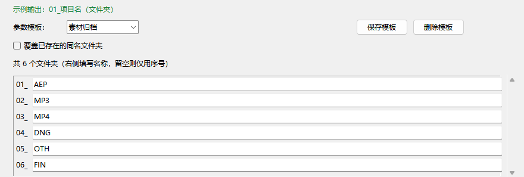
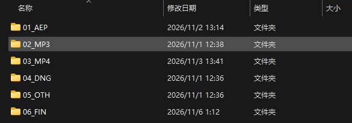

# 批量建文件夹工具 · Batch Folder Creator

[](LICENSE)
[](#项目简介)
[](#附录)

> 序号规则定一次，名字逐行填；一键铺好项目骨架，右键新建文件夹的苦差事交给它。

一个 Windows 单文件 GUI 小工具：在指定目录里，按「**序号前缀 + 你逐行填写的名称**」批量创建空文件夹，用来给项目搭目录骨架。

双击即用，不需要安装 Python，也不需要任何运行库。

**English** — *Batch Folder Creator* is a Windows single-file GUI that creates empty folders in bulk by a numeric prefix plus a list of names you fill line by line. Python + tkinter, no install, no network.
**你可能在找**：批量建文件夹 · 批量新建目录 · 项目目录骨架 · 序号命名文件夹 · batch create folders

## 目录

- [项目简介](#项目简介)
- [功能介绍](#功能介绍)
- [获取与运行](#获取与运行)
- [常见问题](#常见问题)
- [贡献与致谢](#贡献与致谢)
- [附录](#附录)

---

## 项目简介

| | |
|---|---|
| **做什么** | 在指定目录里，按「序号前缀 + 逐行填写的名称」批量创建空文件夹，给项目铺一套有顺序的目录骨架（`01_AEP`、`02_MP3`……） |
| **平台** | Windows 10/11 桌面程序，有单文件 exe，也有 Python 源码 |
| **不做什么** | 不重命名已有文件夹、不做多级嵌套、不导入 Excel / CSV；只建空目录，不往里放文件 |

## 功能介绍

序号规则定一次，名称逐行填，点一下就铺好整批文件夹。


*完整界面：加载模板后的状态*


*模板操作区：存 / 载 / 删命名模板*


*生成结果：6 个带序号的文件夹*

- **序号规则**：11 个预设前缀（`1_`、`01_`、`第1章 `、`(1) ` …）加一个自定义模板串；`{n}` 阿拉伯数字可补零 `{n:02d}`、`{cn}` 中文数字（一、二、三…），其余文字原样保留；模板里没写 `{n}` / `{cn}` 时预览会提示「序号不会变化」
- **逐行清单**：行数决定数量，每行左侧序号、右侧填名；调数量 / 起始 / 格式时已填名称按行保留；留空只生成序号
- **实时预览**：右侧显示首个文件夹的实际名字，如 `01_项目名`
- **参数模板**：整套参数存成命名模板，下次下拉一键回填；存在 exe 同目录 `templates.json`，跟着 exe 走，无内置预设
- **覆盖开关**：关时遇同名跳过并记日志，开时确保文件夹存在（不清空已有内容）
- **运行日志**：逐条显示已创建 / 已跳过 / 失败原因，结束可一键打开目标文件夹

Windows 文件夹名非法字符（`" < > : / \ | ? *`）自动移除。

## 获取与运行

- **直接用（推荐）**：从仓库下载 `dist/批量建文件夹.exe`，双击运行（约 10 MB，免安装）。把 exe 放在哪个目录，默认就在哪个目录建文件夹；`templates.json` 也跟着 exe 走
- **跑源码**：`py -3.12 batch_file_creator.py`（需 Python 3.12 + tkinter）

<details>
<summary>重新打包成单文件 exe</summary>

```bat
build.bat
```

等价于：

```bat
py -3.12 -m PyInstaller --onefile --windowed --clean --icon folder_plus.ico --add-data "assets;assets" --name 批量建文件夹 batch_file_creator.py
```

注意：WorkBuddy 自带的精简版 Python 3.13 没有 tkinter 和 PyInstaller，请用系统 `py -3.12`。若打包时提示无法覆盖旧的 `dist\批量建文件夹.exe`，先手动删掉或改名旧 exe 再跑。

</details>

## 常见问题

<details>
<summary>勾上「覆盖」会清空已有文件夹里的内容吗？</summary>

不会。覆盖开关执行的是 `os.makedirs(exist_ok=True)`，语义是「确保文件夹存在」，不会删除或清空已有内容；同名文件夹会跳过。

</details>

<details>
<summary>中文数字（一、二、三）为什么到 99 之后变回阿拉伯数字？</summary>

`cn_num` 只覆盖 1–99；序号 ≥100 会回退成阿拉伯数字（`100_` 而非 `一百_`）。这是当前实现的上限，不是 bug。

</details>

<details>
<summary>模板换台电脑还在吗？放在只读目录会怎样？</summary>

模板写在 exe 同目录的 `templates.json`，跟着 exe 走，拷到 U 盘或另一台电脑都还在。但若 exe 放在只读目录（如 `Program Files`），保存模板会失败并弹错。

</details>

<details>
<summary>两个文件夹名字填成一样会怎样？</summary>

名称清洗是直接删除非法字符、**不检测清单内重名**；填了两个相同名字时，后者会被跳过（日志里记为已跳过）。

</details>

## 贡献与致谢

**反馈与贡献**

- 遇到问题请到 [Issues](https://github.com/ERunnn/batch-folder-creator/issues) 提交，附上出错截图、复现步骤与 Windows 版本。
- 欢迎 Pull Request；说明改动影响的行为即可，本仓库没有独立的自检测试套件（仅 `docs/make_screenshot.py` 可复跑）。

**致谢**

- 界面基于 Python 标准库 [tkinter](https://docs.python.org/3/library/tkinter.html)。
- 应用图标由 [Pillow](https://python-pillow.org/) 绘制并手工拼装多尺寸 ICO（`make_icon.py`）。
- 本仓库代码采用 [MIT License](LICENSE)。

## 附录

- **文件构成**：`batch_file_creator.py`（主程序，仅标准库 tkinter）、`dist/批量建文件夹.exe`（约 10 MB 成品）、`make_icon.py`（用 Pillow 生成 ICO）、`folder_plus.ico`（9 个尺寸 16–256px 图标）、`build.bat`（打包）、`docs/`（截图与可复跑截图脚本 `make_screenshot.py`）、`templates.json`（运行时生成的参数模板，随 exe 走）
- **技术栈**：仅 Python 标准库 tkinter；PyInstaller 单文件、无控制台窗口；成品 `dist/批量建文件夹.exe` 约 10 MB；构建脚本 `build.bat`；图标由 `make_icon.py` 生成 `folder_plus.ico`
- **实测过 / 没实测过**：纯函数断言（中文数字到 99、各预设、自定义串、非法字符清洗）、临时目录真实 mkdir、ICO 二进制 9 帧解析、`py_compile`、`docs/make_screenshot.py` 真实启动 GUI 抓图并含回填 / 预览断言均通过；人工交互手感（鼠标点击、滚轮、DPI 缩放）、exe 图标在任务栏 / 桌面显示、同类工具对比（仅网页检索）未经逐一实测
- **已知局限**：`cn_num` 仅 1–99，≥100 回退阿拉伯数字；名称清洗不查清单内重名，同名时后者被跳过；覆盖=确保存在而不清空；仅 Windows（`os.startfile` / `iconbitmap` / Windows 非法字符集）；`templates.json` 在只读目录保存会失败并弹错；模板无导入导出、无版本迁移
- **同类工具**：[FolderMaker](https://github.com/fayaznaim/FolderMaker)（C# 单 exe，固定前缀加数字，无格式模板串 / 中文数字 / 参数模板）、[bulk-folder-creator](https://github.com/Harikumarthapa/bulk-folder-creator)（浏览器 Web 工具，导出 ZIP/.bat，不直接建目录）、[汇帮批量建文件夹](https://www.huibang168.com/createfile/detail/tWz9XuukLTcl) 等国产闭源工具、[Bulk Rename Utility](https://www.bulkrenameutility.co.uk/)（主业重命名）、PowerShell / Excel + .bat（系统自带，无界面）；2026-11-14 检索，**未逐一安装实测**
- **许可**：代码 [MIT](LICENSE) · Copyright (c) 2026 Huang Yirun
- **更新记录**：本仓库暂无独立 `CHANGELOG.md`，版本与改动以 git 提交历史为准

<!-- AI-BRIEF:START
定位/受众：Windows 单文件 GUI，按「序号前缀 + 逐行填写名」批量建空文件夹搭项目骨架；面向个人项目目录规范化，无 CLI/库/API，入口 batch_file_creator.py 的 main() 直接起 Tk。
差异1（可核实）：序号前缀是可编辑模板串，FORMAT_PRESETS 支持 {n}、{n:02d}、{cn} 中文数字与自定义串；检索到的同类 https://github.com/fayaznaim/FolderMaker 与 https://github.com/Harikumarthapa/bulk-folder-creator 多为固定前缀加数字或补零，此差异未经逐一安装实测。
差异2（可核实）：名称清单是逐行 Entry 列表（rebuild_rows），非多行文本框粘贴；整套参数可存/载/删为命名模板（_collect_config / _apply_config，文件 templates.json，无内置预设）。
技术：仅 Python 标准库 tkinter；PyInstaller 单文件且无控制台窗口；成品 dist/批量建文件夹.exe 约 10 MB；构建 build.bat；图标 make_icon.py 生成 folder_plus.ico。
已实测：纯函数断言、临时目录真实 mkdir、ICO 二进制 9 帧解析、py_compile 均通过；docs/make_screenshot.py 真实启动 GUI 并抓 docs/screenshot-templates.png，内含模板回填/预览断言；并修复预览把 {n:02d} 误判缺占位符的 bug。
未验证：人工交互（鼠标点击、滚轮滚动、DPI 缩放）未经人手逐项验证；exe 图标在任务栏/桌面的显示效果未验证；同类工具对比仅基于网页检索。
局限1：cn_num 仅 1..99，>=100 回退阿拉伯数字；sanitize 直接删非法字符且不检测清单内重名，同名时后项被跳过。
局限2：勾选覆盖时执行 os.makedirs(exist_ok=True)，不清空已有内容，语义是「确保存在」而非重建。
局限3：仅 Windows（os.startfile / iconbitmap / Windows 非法字符集）；templates.json 写在 exe 同目录，目录只读时保存模板失败并弹错。
局限4：仓库无 tests/，多数断言为临时内联脚本、不可复跑，仅 docs/make_screenshot.py 可复跑；模板无导入导出、无版本迁移。
维护注意：make_icon.py 手工拼 ICO 二进制，因 PIL 的 save(sizes=..., append_images=...) 只写首帧，曾导致图标仅 16px 而糊；_on_canvas_configure 须同时钉 rows_frame 宽度，否则逐行 Entry 溢出卡片。
git 历史：本仓库初始化时仅 1 条提交，无「近 20 条提交」可引用；事实来自当前文件、README.md 及 docs/ 下截图。
AI-BRIEF:END -->
